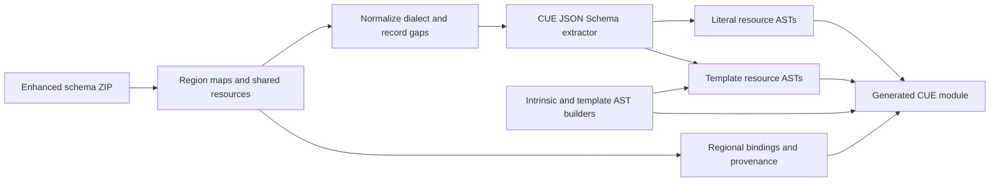

# Research and implementation notes

Investigated on October 12, 2026. Source repositories were inspected directly, including the earlier CUE generator, cfn-lint's schema manager, its function validators, its template section schemas, and AWS's enhanced-schema assembler.

## The earlier generator

[cue-sh/cfn-cue](https://github.com/cue-sh/cfn-cue), inspected at commit `25d477e39068f08a646a5484750510d3d748dae7`, uses CUE v0.4.0 and the old CloudFormation Resource Specification layout. Its latest visible release was `v0.4.0-50.0.0` in December 2021. The Go entry point constructs CUE ASTs from `ResourceTypes`, `PropertyTypes`, and cfn-lint's old extended specs. The hand-maintained [intrinsic definitions](https://github.com/cue-sh/cfn-cue/blob/main/aws/fn/fn.cue) already contain recursive function references and distinguish some scalar/list forms.

Useful ideas to retain are AST construction, required versus optional fields, service/region access, a reusable intrinsic package, and separate definitions for recursive resource properties. The hard-coded old resource-spec models and property-specific repairs are replaced by the provider schema input and CUE's current JSON Schema decoder.

## Current resource schema source

cfn-lint v1 migrated to Resource Provider Schemas based on JSON Schema with AWS extensions. Its current [schema manager](https://github.com/aws-cloudformation/cfn-lint/blob/be66fb3e224b41c85065cb3002ad0b24e31db535/src/cfnlint/schema/manager.py) downloads:

- [schemas-cfn-lint.zip](https://github.com/aws-cloudformation/resource-provider-enhanced-schemas/releases/download/latest/schemas-cfn-lint.zip)
- [version.json](https://github.com/aws-cloudformation/resource-provider-enhanced-schemas/releases/download/latest/version.json)

The source is now [aws-cloudformation/resource-provider-enhanced-schemas](https://github.com/aws-cloudformation/resource-provider-enhanced-schemas). The ZIP's layout is `providers/<region>.json` mapping resource type names to hashes, and `resources/<hash>.json` holding shared schemas. `providers/sam.json` is a separate, region-independent SAM map. The enhanced project adds constraints from API models and manual corrections and publishes release assets.

The included archive's SHA-256 is `140973ce07b875afb8d7e3517e9aca28734c9bffd55dc0e90c344bae38e0e067`. Independently retrieved release metadata reports `schema_date: 2026-10-12T20:31:47Z`. The checksum identifies the exact archive; the moving `latest` URL is not a reproducibility guarantee.

This snapshot contains 45 region maps, including sovereign and isolated partitions, and 1,879 resource files. Thirteen files belong to SAM. The default generator selects all 1,866 CloudFormation resource types and preserves the 58,816 regional availability bindings. It discovers region names from the bundle and does not silently fall back to us-east-1.

The [AWS resource-schema repository](https://github.com/aws-cloudformation/cloudformation-resource-schema) describes the provider dialect and lifecycle annotations. These are resource provider JSON Schemas, rather than OpenAPI documents.

## Template sections and intrinsics

Current cfn-lint separates structural schemas from context-aware validation:

- [Template section configuration](https://github.com/aws-cloudformation/cfn-lint/tree/be66fb3e224b41c85065cb3002ad0b24e31db535/src/cfnlint/data/schemas/other/template)
- [Function argument schemas](https://github.com/aws-cloudformation/cfn-lint/tree/be66fb3e224b41c85065cb3002ad0b24e31db535/src/cfnlint/data/schemas/other/functions)
- [Function validators](https://github.com/aws-cloudformation/cfn-lint/tree/be66fb3e224b41c85065cb3002ad0b24e31db535/src/cfnlint/rules/functions)
- [Resources, policies, parameters, mappings, outputs, and rules](https://github.com/aws-cloudformation/cfn-lint/tree/be66fb3e224b41c85065cb3002ad0b24e31db535/src/cfnlint/data/schemas/other)

`cfnContext` records allowed functions and the underlying argument schema. Other checks use `dynamicValidation`, transform context, reference resolution, or Python validators. These cannot be faithfully imported as plain JSON Schema keywords. A mechanically converted editor schema alone is therefore insufficient for full CloudFormation validation.

The separate [cloudformation-template-schema project](https://github.com/aws-cloudformation/cloudformation-template-schema) inspected here still has a Java generator based on the old resource specifications. The implementation in this folder uses the current cfn-lint section/function sources as references and builds a new AST template model instead of depending on that older generator.

Newer intrinsic coverage includes [Fn::GetStackOutput](https://docs.aws.amazon.com/AWSCloudFormation/latest/TemplateReference/intrinsic-function-reference-getstackoutput.html), Rules functions, LanguageExtensions functions, and resource ForEach fragments. Current [Fn::FindInMap documentation](https://docs.aws.amazon.com/AWSCloudFormation/latest/TemplateReference/intrinsic-function-reference-findinmap.html) also describes the optional DefaultValue parameter.

## Implemented architecture

The Go generator uses `cuelang.org/go/cue/ast`, `format`, and `encoding/jsonschema` v0.18.0-alpha.3. This pre-release requires Go 1.26; generated modules declare CUE language v0.18.0. It translates custom required/exclusion/enum keywords, handles local schema references without recursively expanding them, and records unsupported validation constraints. Read-only instance paths are removed from template inputs while referenced source property schemas are preserved privately.

The pre-release upgrade exposed an incomplete disjunction for IAM policy documents whose provider schema permits either strings or objects. The converter now adds only intrinsic expression alternatives beside constrained literals and selects both string and object expression categories for these properties. Open object values recursively validate nested expressions. Regression tests and the real S3/IAM integration check pass with this change.

Regional templates currently use a discriminated union of resource envelopes and a type-to-schema table. This passes focused correctness tests. Full us-east-1 evaluation exceeded a three-minute limit with CUE v0.17.1 and consumed substantial memory. The v0.18.0-alpha.3 recheck also timed out after three minutes, with `GOMEMLIMIT=2GiB` as the Go memory target. Attempts to delay a type-indexed property-table lookup also had correctness or evaluation costs, so the supplied version retains the verified union representation. Filtered modules are the usable authoring path for this first version; aggregate evaluation remains an open issue.

For intrinsics, a common closed function table and result-type views keep evaluation practical. Detailed, mutually recursive per-argument allowlists caused CUE to expand many combinations before a concrete template was available. The current representation preserves recursive shape checking and known result categories while leaving exact function/context permissions to cfn-lint. No arbitrary recursion depth limit is used.

## Property presence rules

Upstream schemas express exclusions with `dependentExcluded`, and exactly-one or at-least-one groups with `requiredXor`, `requiredOr`, or `oneOf`/`anyOf` over single `required` lists. Through the extractor these became `matchN` checks whose failures read `2 matched, expected 1` or `1 matched, expected 0`. The generator now places a placeholder property on the object, and after extraction replaces it with `if A != _|_ {B?: error("B cannot be used with A")}` comprehensions plus a `matchN(>=1, ...)` conjoined outside the closed struct. In the 2026-10-12 snapshot this covers 80 resource schemas.

Findings with CUE v0.18.0-alpha.3:

- The extractor quotes property labels, and quoted labels do not bind identifiers. Referenced properties are relabeled as identifiers; only capitalized names qualify, so imports, builtins and generated definitions can't be captured.
- `error()` in a comprehension guarded by absence (`if A == _|_ && B == _|_ {_x: error(...)}`) fires when the definition is evaluated on its own. At-least-one rules therefore use `matchN`, which lists the missing fields.
- Through a regional `#Template`, a failing resource's own errors are sometimes dropped and only the other types' `Type` conflicts are shown. Validating with `#ResourceTypes["AWS::..."]` shows them.

## Next design decisions

1. **Aggregate evaluation and property-specific intrinsic constraints.** Establish a representation that loads a complete region without expensive evaluation of unused resource schemas. Benchmark CUE dispatch, per-service packages and late binding against real templates. Then specialize `Fn::If` branches and literal arguments with the expected property schema. This would catch a conditional branch with an invalid enum value or an invalid nested property shape, beyond the current result-type check, while avoiding a new expansion problem.
2. **Semantic validation.** Keep cfn-lint as the external authority initially. A later Go pass could resolve parameter/resource names, infer Ref/GetAtt result types, validate Sub variables and condition names, and evaluate simple literal expressions.
3. **Template fidelity.** Import more current section constraints, fully type creation/update policies and parameter type names, and handle transform context. Complete ForEach support should describe fragments in Resources, Conditions and Outputs and expand loops before checking concrete resource properties.
4. **Package ergonomics.** Hash packages avoid duplicated schemas. Service packages and stable resource aliases could give better authoring/completion while keeping hashes internal. Preserve each region's availability map rather than flattening everything into a globally permissive union.
5. **Updates and compatibility.** Pin upstream archives and checksums, publish generated CUE modules separately from the Go generator, and compare availability/property changes between snapshots. Consider adapters for the earlier service/region imports once the desired public module layout is settled.

The implementation provides a runnable starting point for those decisions. The source repository is [CUEFormation/cfn-cue](https://github.com/CUEFormation/cfn-cue). Generated CUE modules have not been published to a CUE registry.
