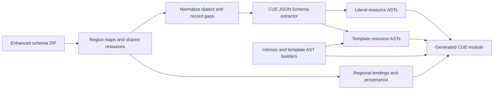

# Research and implementation notes

Investigated on October 12, 2026. Source repositories were inspected directly, including the earlier CUE generator, cfn-lint's schema manager, its function validators, its template section schemas, and AWS's enhanced-schema assembler.

## The earlier generator

[cue-sh/cfn-cue](https://github.com/cue-sh/cfn-cue), inspected at commit `25d477e39068f08a646a5484750510d3d748dae7`, uses CUE v0.4.0 and the old CloudFormation Resource Specification layout. Its latest visible release was `v0.4.0-50.0.0` in December 2021. The Go entry point constructs CUE ASTs from `ResourceTypes`, `PropertyTypes`, and cfn-lint's old extended specs. The hand-maintained [intrinsic definitions](https://github.com/cue-sh/cfn-cue/blob/main/aws/fn/fn.cue) already contain recursive function references and distinguish some scalar/list forms.

Useful ideas to retain are AST construction, required versus optional fields, service/region access, a reusable intrinsic package, and separate definitions for recursive resource properties. The hard-coded old resource-spec models and property-specific repairs are replaced by the provider schema input and CUE's current JSON Schema decoder.

## Current resource schema source

cfn-lint v1 migrated to Resource Provider Schemas based on JSON Schema with AWS extensions. Its current [schema manager](https://github.com/aws-cloudformation/cfn-lint/blob/be66fb3e224b41c85065cb3002ad0b24e31db535/src/cfnlint/schema/manager.py) downloads:

- [schemas-cfn-lint.zip](https://github.com/aws-cloudformation/resource-provider-enhanced-schemas/releases/download/latest/schemas-cfn-lint.zip)
- [version.json](https://github.com/aws-cloudformation/resource-provider-enhanced-schemas/releases/download/latest/version.json)

The source is now [aws-cloudformation/resource-provider-enhanced-schemas](https://github.com/aws-cloudformation/resource-provider-enhanced-schemas). The ZIP's layout is `providers/<region>.json` mapping resource type names to hashes, and `resources/<hash>.json` holding shared schemas. `providers/sam.json` is a separate, region-independent SAM map. The enhanced project adds constraints from API models and manual corrections and publishes release assets.

The included archive's SHA-256 is `140973ce07b875afb8d7e3517e9aca28734c9bffd55dc0e90c344bae38e0e067`. Independently retrieved release metadata reports `schema_date: 2026-10-12T20:31:47Z`. The checksum identifies the exact archive; the moving `latest` URL is not a reproducibility guarantee.

This snapshot contains 45 region maps, including sovereign and isolated partitions, and 1,879 resource files. Thirteen files belong to SAM. The default generator selects all 1,866 CloudFormation resource types and preserves the 58,816 regional availability bindings. It discovers region names from the bundle and does not silently fall back to us-east-1.

The [AWS resource-schema repository](https://github.com/aws-cloudformation/cloudformation-resource-schema) describes the provider dialect and lifecycle annotations. These are resource provider JSON Schemas, rather than OpenAPI documents.

## Template sections and intrinsics

Current cfn-lint separates structural schemas from context-aware validation:

- [Template section configuration](https://github.com/aws-cloudformation/cfn-lint/tree/be66fb3e224b41c85065cb3002ad0b24e31db535/src/cfnlint/data/schemas/other/template)
- [Function argument schemas](https://github.com/aws-cloudformation/cfn-lint/tree/be66fb3e224b41c85065cb3002ad0b24e31db535/src/cfnlint/data/schemas/other/functions)
- [Function validators](https://github.com/aws-cloudformation/cfn-lint/tree/be66fb3e224b41c85065cb3002ad0b24e31db535/src/cfnlint/rules/functions)
- [Resources, policies, parameters, mappings, outputs, and rules](https://github.com/aws-cloudformation/cfn-lint/tree/be66fb3e224b41c85065cb3002ad0b24e31db535/src/cfnlint/data/schemas/other)

`cfnContext` records allowed functions and the underlying argument schema. Other checks use `dynamicValidation`, transform context, reference resolution, or Python validators. These cannot be faithfully imported as plain JSON Schema keywords. A mechanically converted editor schema alone is therefore insufficient for full CloudFormation validation.

The separate [cloudformation-template-schema project](https://github.com/aws-cloudformation/cloudformation-template-schema) inspected here still has a Java generator based on the old resource specifications. The implementation in this folder uses the current cfn-lint section/function sources as references and builds a new AST template model instead of depending on that older generator.

Newer intrinsic coverage includes [Fn::GetStackOutput](https://docs.aws.amazon.com/AWSCloudFormation/latest/TemplateReference/intrinsic-function-reference-getstackoutput.html), Rules functions, LanguageExtensions functions, and resource ForEach fragments. Current [Fn::FindInMap documentation](https://docs.aws.amazon.com/AWSCloudFormation/latest/TemplateReference/intrinsic-function-reference-findinmap.html) also describes the optional DefaultValue parameter.

## Implemented architecture

The Go generator uses `cuelang.org/go/cue/ast`, `format`, and `encoding/jsonschema` v0.18.0-alpha.3. This pre-release requires Go 1.26; generated modules declare CUE language v0.18.0. It translates custom required/exclusion/enum keywords, handles local schema references without recursively expanding them, and records unsupported validation constraints. Read-only instance paths are removed from template inputs while referenced source property schemas are preserved privately.

The pre-release upgrade exposed an incomplete disjunction for IAM policy documents whose provider schema permits either strings or objects. The converter now adds only intrinsic expression alternatives beside constrained literals and selects both string and object expression categories for these properties. Open object values recursively validate nested expressions. Regression tests and the real S3/IAM integration check pass with this change.

Regional templates first used a discriminated union of resource envelopes and a type-to-schema table. Full us-east-1 evaluation exceeded a three-minute limit with CUE v0.17.1 and with v0.18.0-alpha.3 (`GOMEMLIMIT=2GiB`). An earlier attempt to delay a type-indexed property-table lookup had correctness or evaluation costs, so the union was kept.

**Update, October 14, 2026:** most of that cost came from the intrinsic definitions, not the union. Function keys were optional fields (`Ref?: string`). In CUE v0.18, an optional field's type is evaluated whenever its struct is an arm of a disjunction, and every property's `literal | fn.#XExpression` is one. Each unset property therefore cost about 25 ms per evaluation, even with no data. Pattern constraints (`[=~"^Ref$"]: string`) apply only to keys that are present; a regex label is needed because `format.Simplify` turns `["Ref"]: string` back into `Ref?: string`. Loading `AWS::S3::Bucket` went from 7.9 s to 20 ms and validating one from 1.7 s to 3 ms; generator tests went from 70 s to 1.5 s. Unifying with `{}` cost as much as unifying with data, and `Validate` added nothing; the time was spent evaluating the definition. A standalone reproducer shows 3.6 million unifications with optional keys against 123,000 with patterns.

With fast intrinsics, the union itself cost about 0.3 ms per resource type for every resource, 0.5 s per resource in a complete region. `#Resources` now selects `#ResourceTypes[R.Type]` through a postfix alias (`[base.#LogicalID]~(_, R)`), with `Custom::` names routed to the custom-resource schema. CloudFormation requires `Type` to be a literal string, so the lookup is concrete. This costs about 1 ms per resource regardless of region size, and an unknown type reports `undefined field: "AWS::Nope::Thing"` instead of one `Type` conflict per resource type. On 210 templates and edge cases it accepted and rejected exactly what the union did. The full regional package no longer defines the union. See [BENCHMARKS.md](BENCHMARKS.md).

For intrinsics, a common closed function table and result-type views keep evaluation practical. Detailed, mutually recursive per-argument allowlists caused CUE to expand many combinations before a concrete template was available. The current representation preserves recursive shape checking and known result categories while leaving exact function/context permissions to cfn-lint. No arbitrary recursion depth limit is used.

## IAM policy profiles

Investigated on October 13, 2026. About 80 properties in the snapshot hold IAM-style policies, and provider schemas type them as open objects or strings. The only earlier CUE work found, [jrbeverly/cuelang-aws-iam-policy-exploration](https://github.com/jrbeverly/cuelang-aws-iam-policy-exploration), is an abandoned, unlicensed experiment covering S3 identity policies. The `iam` package is a new implementation. The generator substitutes its profiles for 13 resource types listed in `internal/generate/iam.go`. Property names alone don't select the profile: several `*Policy` properties use other grammars, and `AWS::Organizations::Policy.Content` depends on `Type`.

Findings with CUE v0.18.0-alpha.3 (timings predate the pattern-constraint intrinsics):

- **Closedness:** `matchN` embedded in a definition (`#S: {a?: _, matchN(...)}` or `#S: {...} & matchN(...)`) admits undeclared fields. `close({...}) & matchN(...)` stays closed.
- **No parameterized definitions:** a nested definition used as a parameter (`_#Document & {#S: #TrustStatement}`) is validated as an abstract value when the result sits in a disjunction, and its `matchN` checks then fail. Each profile therefore spells out its document.
- **Narrowing cost:** narrowing a statement (`#Statement & {Action?: ...} & matchN(...)`) intersects two value disjunctions per field. Inside the statement entry disjunction, 20 trust statements took 15 s. Composing each profile as one closed struct took 0.2 s. Forbidding a field with `error()` or `_|_` also doubled the cost; leaving the field out is cheaper.
- **Option C is too slow:** unifying a profile with the provider type (`{[string]: fn.#Value} | ...`) cost 21 s for one role, against 0.5 s for the schema alone and 1.7 s with the provider type replaced. The generator therefore replaces the type instead of adding constraints to it.
- **Faster than provider types at scale:** with 90 resources in a filtered region, validation took 42 s with profiles and 57 s with provider types.
- **Validation gaps:** `json.Validate` does not reliably fail `matchN` alternatives that use required fields (`{Principal!: _}`). In some cases CUE reports only the shallowest error of a nested disjunction, so statement errors can appear as `field not allowed` on the document.

`testdata/iam.cases` holds the accepted and rejected documents that `TestIAMProfiles` runs. IAM rules for SCPs and RCPs follow the AWS Organizations [SCP syntax](https://docs.aws.amazon.com/organizations/latest/userguide/orgs_manage_policies_scps_syntax.html) and [RCP syntax](https://docs.aws.amazon.com/organizations/latest/userguide/orgs_manage_policies_rcps_syntax.html) pages.

## Property presence rules

Upstream schemas express exclusions with `dependentExcluded`, and exactly-one or at-least-one groups with `requiredXor`, `requiredOr`, or `oneOf`/`anyOf` over single `required` lists. Through the extractor these became `matchN` checks whose failures read `2 matched, expected 1` or `1 matched, expected 0`. The generator now places a placeholder property on the object, and after extraction replaces it with `if A != _|_ {B?: error("B cannot be used with A")}` comprehensions plus a `matchN(>=1, ...)` conjoined outside the closed struct. In the 2026-10-12 snapshot this covers 80 resource schemas.

Findings with CUE v0.18.0-alpha.3:

- The extractor quotes property labels, and quoted labels do not bind identifiers. Referenced properties are relabeled as identifiers; only capitalized names qualify, so imports, builtins and generated definitions can't be captured.
- `error()` in a comprehension guarded by absence (`if A == _|_ && B == _|_ {_x: error(...)}`) fires when the definition is evaluated on its own. At-least-one rules therefore use `matchN`, which lists the missing fields.
- Through a regional `#Template`, a failing resource's own errors are sometimes dropped and only the other types' `Type` conflicts are shown. Validating with `#ResourceTypes["AWS::..."]` shows them.

## Next design decisions

1. **Region load time and property-specific intrinsic constraints.** Loading a complete region still takes about 2.7 s because every resource package is imported. Per-service packages, a module generated for a template's types, or a long-running validator would avoid it. Then specialize `Fn::If` branches and literal arguments with the expected property schema. This would catch a conditional branch with an invalid enum value or an invalid nested property shape, beyond the current result-type check, while avoiding a new expansion problem.
2. **Semantic validation.** `internal/semantic` resolves parameter, resource, condition and mapping names, GetAtt attributes, Sub variables and dependency cycles, classifying conditions without choosing parameter values ([design](docs/semantic-validation.md)). Next: infer Ref/GetAtt result types, check required properties across `Fn::If` branches (issue #11), and add service rules that read another resource's properties. Keep cfn-lint as the external authority for the rest.
3. **Template fidelity.** Import more current section constraints, fully type creation/update policies and parameter type names, and handle transform context. Complete ForEach support should describe fragments in Resources, Conditions and Outputs and expand loops before checking concrete resource properties.
4. **Package ergonomics.** Hash packages avoid duplicated schemas. Service packages and stable resource aliases could give better authoring/completion while keeping hashes internal. Preserve each region's availability map rather than flattening everything into a globally permissive union.
5. **IAM policy coverage.** Extend the placement table to the remaining resource policies with `#ResourcePolicyValue` or service profiles, and report unlisted policy-like properties as diagnostics when the snapshot changes. An action and condition-key catalog generated from the AWS Service Authorization Reference JSON should be a separate, opt-in package because of its size.
6. **Updates and compatibility.** Pin upstream archives and checksums, publish generated CUE modules separately from the Go generator, and compare availability/property changes between snapshots. Consider adapters for the earlier service/region imports once the desired public module layout is settled.

The implementation provides a runnable starting point for those decisions. The source repository is [CUEFormation/cfn-cue](https://github.com/CUEFormation/cfn-cue). Generated CUE modules have not been published to a CUE registry.
